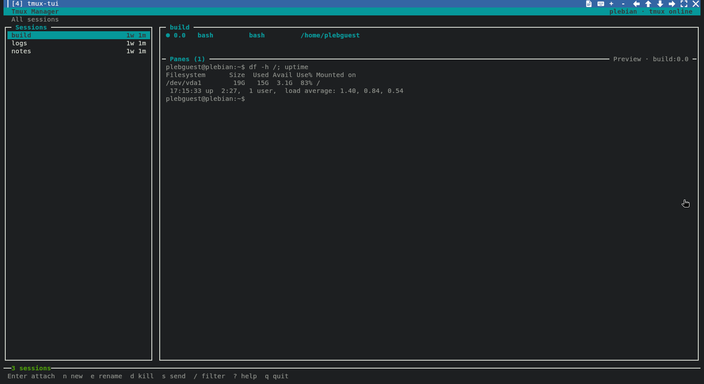

# tmux-tui

`tmux-tui` is a friendly, keyboard-and-mouse terminal manager for tmux. It is
the **Tmux Manager** shipped by Kilix 95, Pleb, and Plebian-OS.

The UI does not implement a second tmux control layer. Every read and mutation
goes through the bundled [`tmux-cli`](https://github.com/itsmygithubacct/tmux-cli)
submodule and its stable `tb --json` contract.

**Status:** ships in Plebian-OS 0.2.3. Kilix pins this repository and its
tmux-cli submodule by commit in `scripts/install-tmux-tui.sh`; Pleb runs
`kilix tmux --install-only --with-tb` at first boot, and the Kilix content
catalog lists it as **Tmux Sessions** (`kilix-tmux-manager`, a system entry
that runs `kilix tmux`).



## Features

- session list with window, client, and idle indicators
- per-session pane list with command, working directory, and active state
- live scrollback preview of the selected pane, fetched with the state snapshot
- create, rename, kill, filter, and send-command actions
- attach to an exact pane; detaching returns to the manager
- stable pane selection across tmux window/pane reordering
- filtering across session names, window names, commands, and working directories
- keyboard navigation and mouse selection
- cell-aware Unicode rendering and a responsive colored curses layout
- no Python package dependencies

## Run

Requirements are Python 3.10+, tmux, and a terminal:

```bash
git clone --recursive https://github.com/itsmygithubacct/tmux-tui.git
cd tmux-tui
./tmux_tui.py
```

If the submodule is not initialized, a sibling `../tmux-cli/tb.py` or an
installed `tb` command is used as a developer fallback. Select another
entrypoint explicitly with `--tb /path/to/tb.py`. An explicit `--tb` or
`TMUX_CLI` value must resolve to a runnable entrypoint; a typo fails clearly
instead of silently selecting a different backend.

With a current tmux-cli, each steady-state refresh combines session state,
stable pane IDs, and the selected-pane preview into one process invocation.
The manager automatically falls back to the original snapshot/capture sequence
when used with an older tmux-cli.

## Keys

| Key | Action |
|---|---|
| `↑`/`↓`, `j`/`k` | move through sessions or panes |
| `←`/`→`, `Tab` | switch between the session and pane lists |
| `Enter`, `o` | attach to the selected pane |
| `n` | create a session |
| `e` | rename a session |
| `d` | kill a session after confirmation |
| `s` | type a command and Enter into the selected pane |
| `/` | filter sessions and pane details |
| `p` | toggle live preview |
| `r` | refresh now |
| `?` | show in-app help |
| `q` | quit |

## Install

```bash
make install PREFIX="$HOME/.local"
```

This atomically links `tmux-tui` into `$PREFIX/bin`. It refuses to overwrite a
regular file, an unmanaged symlink, or a symlinked `bin` directory. To publish
tmux-cli's conventional short command too:

```bash
make install-tb PREFIX="$HOME/.local"
```

Pleb and Plebian-OS install both commands. Standalone Kilix downloads the
pinned source closure on first `kilix tmux` launch; `kilix tmux --with-tb`
also installs the `tb` alias.

Command-line options: `--tb PATH`, `--refresh SECONDS` (default 1),
`--preview-lines N` (default 80), `--no-preview`, `--session NAME` and
`--version`.

## How it works

`tmux_tui.py` is a single curses program with no Python package
dependencies. Each refresh runs the bundled `tmux-cli/tb.py` as a subprocess
with `--json`: `snapshot --tmux-only` for sessions, windows and stable pane
IDs (with the selected pane's preview when the tmux-cli supports it), then
`new`, `rename`, `kill` and `type` for actions. `attach` runs `tb attach` in
the foreground without `--json`, so detaching returns to the manager. Because
the manager only parses tb's versioned envelope, tmux behaviour, targeting
rules and error codes are defined once, in tmux-cli.

```
tmux-tui (curses)  --subprocess, --json-->  tmux-cli/tb.py  --> tmux server
```

## Test

```bash
make check
```

`make check` runs the unit and installer-safety tests, compiles the entrypoint,
and verifies that the source and `VERSION` file agree.

## Related repositories

- [tmux-cli](https://github.com/itsmygithubacct/tmux-cli#readme) — the `tb` CLI this manager drives (submodule)
- [tmux-browse](https://github.com/itsmygithubacct/tmux-browse#readme) — the same CLI core as a web dashboard
- [kilix](https://github.com/itsmygithubacct/kilix#readme) — `kilix tmux` installs and launches this manager at a pinned commit
- [pleb](https://github.com/itsmygithubacct/pleb#readme) — installs it at first boot
- [kilix-content](https://github.com/itsmygithubacct/kilix-content#readme) — the catalog entry `kilix-tmux-manager`

## Part of Plebian-OS

tmux-tui is one of the repositories behind
[Plebian-OS](https://github.com/itsmygithubacct/plebian-os#readme), a Debian
install whose desktop is [Kilix](https://github.com/itsmygithubacct/kilix#readme)
running the [Kilix 95](https://github.com/itsmygithubacct/kilix-95#readme)
desktop through [Pleb](https://github.com/itsmygithubacct/pleb#readme).
It is installed for the desktop user at first boot and opened by `kilix tmux`.
The map of every repository and how it ships is on the
[components page](https://github.com/itsmygithubacct/plebian-os/blob/main/docs/components.md).

## License

[MIT](LICENSE)
